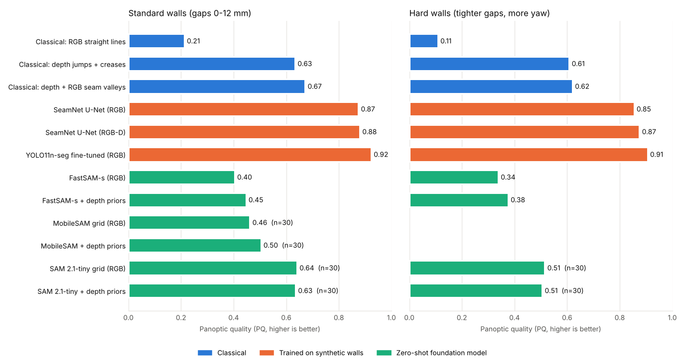
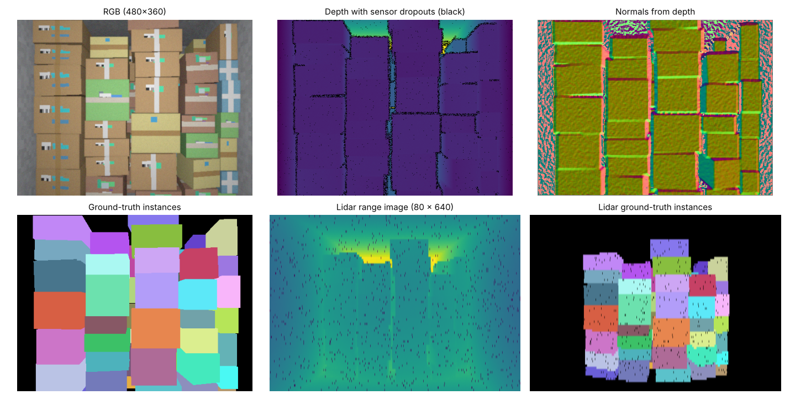
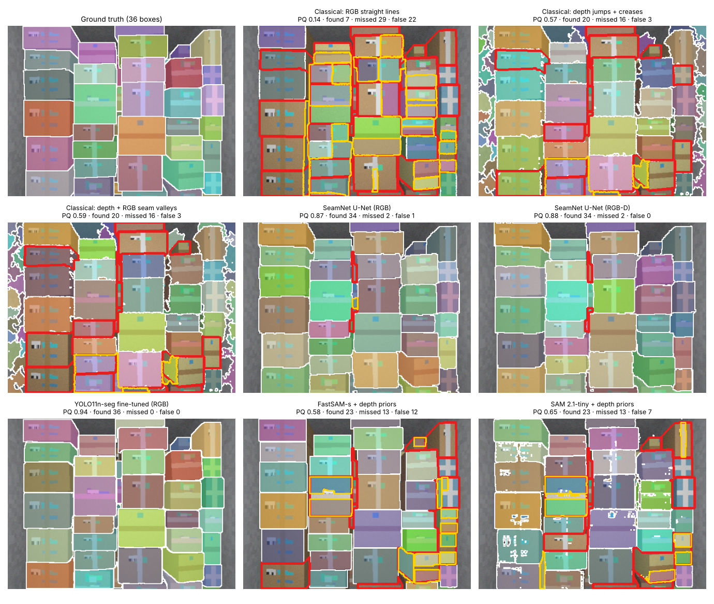
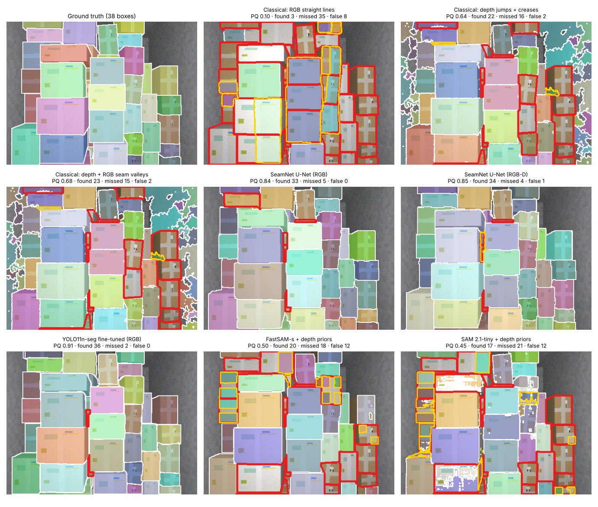
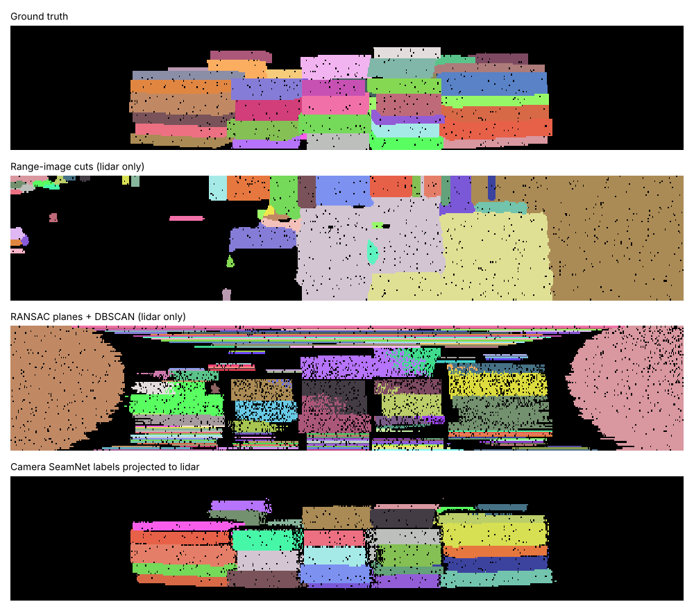
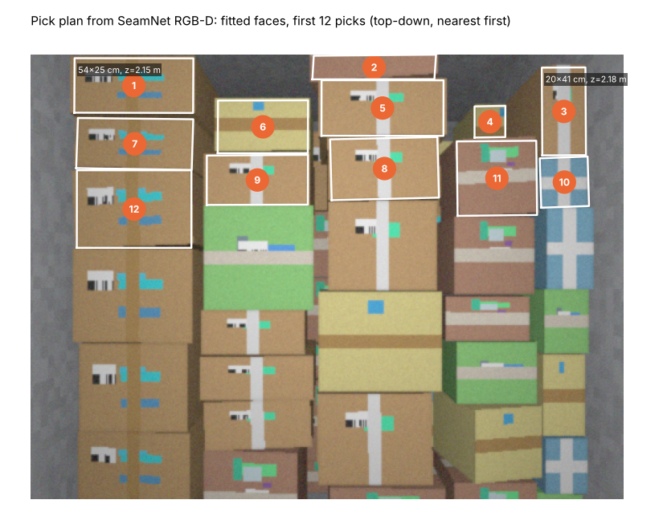
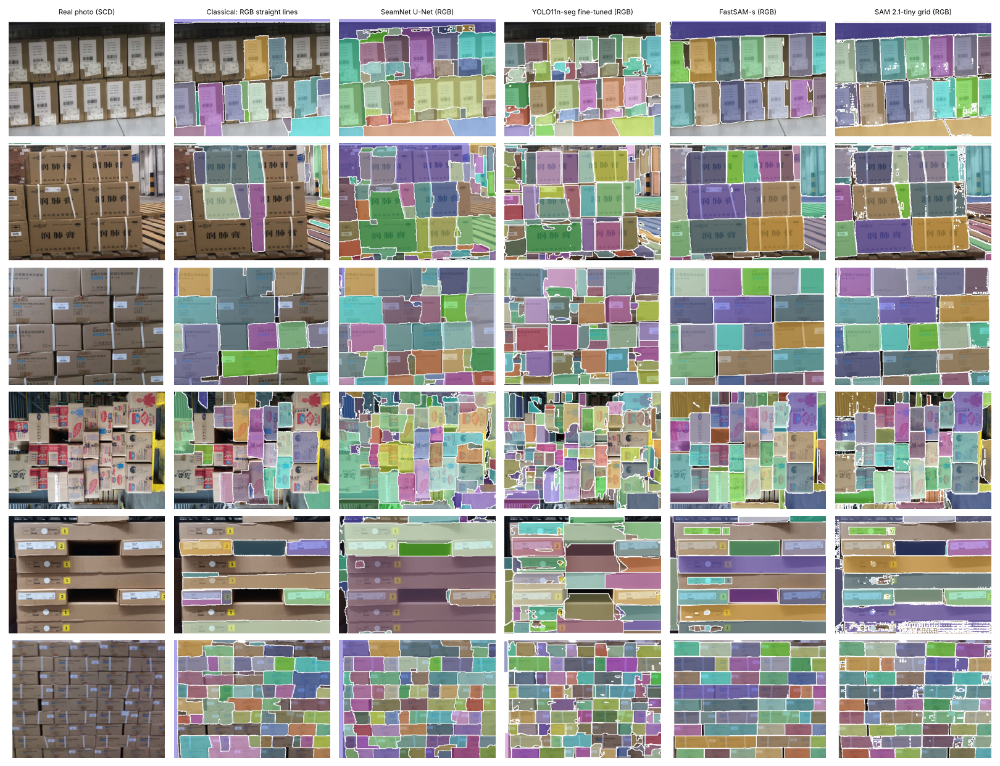

# Carton-wall perception: classical vs. learned vs. foundation models

Detecting and segmenting stacked cardboard boxes for robotic truck and container unloading, with a camera
(RGB-D) and a lidar. Every method in this folder runs end to end on a CPU and is scored against exact ground
truth from a procedural box-wall simulator, so the comparisons are apples to apples.

**Write-up:** [perceptionstack.dev — Unloading a box wall](https://perceptionstack.dev/carton-wall-perception/)
· **Architecture deep dive:** [`docs/ARCHITECTURES.md`](docs/ARCHITECTURES.md)
· **All numbers:** [`results/RESULTS.md`](results/RESULTS.md)



## What is here

| Family | Methods | Code |
|---|---|---|
| Classical, camera | RGB straight lines · depth jumps + creases · depth + RGB seam valleys | `boxwall/classical.py` |
| Classical, lidar | range-image cuts · RANSAC planes + DBSCAN · camera-to-lidar label transfer | `boxwall/lidar.py` |
| Trained here | **SeamNet** (1.1 M-param RGB-D U-Net that segments seams) · YOLO11n-seg fine-tuned | `boxwall/seamnet.py`, `scripts/` |
| Zero-shot | FastSAM-s · MobileSAM · SAM 2.1-tiny, each with and without a depth-prior selector | `boxwall/zeroshot.py` |
| Shared | depth hole filling, normals, RANSAC plane fit, face rectangle, pick planner, metrics | `boxwall/geometry.py`, `boxwall/evaluate.py` |

## The simulator

`boxwall/scene.py` + `boxwall/render.py` build walls the way trailers are loaded: columns of cartons of random
size (25–62 cm wide, 18–50 cm tall), stacked from the floor, with a second row behind. The difficulty knobs:

- gaps of 0–12 mm between boxes (halved in the hard split);
- yaw up to ~±8°, roll ~±3°, pushed-in boxes, and missing front boxes that reveal the row behind;
- 2–6 SKUs per wall, so neighbouring boxes share print, tape and labels (the repeated-texture problem);
- random "seam darkness", so in some walls the seams between flush boxes are almost invisible;
- a point light on the robot, so seams and recesses fall into shadow.

A vectorised ray caster renders RGB (480×360), depth with distance-dependent noise and dropouts at
discontinuities, normals, instance ids and per-box 6-DoF ground truth. The same scene is scanned by a
simulated 80-ring lidar mounted above the camera.

| Split | Scenes | Difficulty | Lidar |
|---|---:|---|---|
| train | 1,200 | standard | – |
| val | 80 | standard | – |
| test | 100 | standard | ✓ |
| test_hard | 100 | 1.8× (tighter gaps, more yaw/tilt) | ✓ |



## Results

Headline numbers: panoptic quality on 100 standard / 100 hard walls (SAM models scored on 30 each).

| Method | Standard | Hard |
|---|---:|---:|
| YOLO11n-seg fine-tuned on synthetic walls (RGB) | 0.92 | 0.91 |
| SeamNet U-Net, RGB-D (1.1 M params) | 0.88 | 0.87 |
| SeamNet U-Net, RGB | 0.87 | 0.85 |
| Classical: depth edges + RGB seam valleys | 0.67 | 0.62 |
| SAM 2.1-tiny, 192-point grid (zero-shot) | 0.64 | 0.51 |
| FastSAM-s + depth priors (zero-shot) | 0.45 | 0.38 |
| Classical: RGB straight lines | 0.21 | 0.11 |

On the lidar, lidar-only methods reach F1 0.09–0.16, against 0.92 for camera labels projected onto the
points. **On real photos the ranking flips**: the synthetic-trained networks fragment real boxes, while FastSAM
and SAM 2.1 segment them cleanly (see the last figure). The practical recipe is to label real data with SAM
and distil it into the small network.

See [`results/RESULTS.md`](results/RESULTS.md) for the full tables (F1 at IoU 0.5 and 0.75, panoptic quality,
face-normal / centre / size error against ground truth, CPU time). Qualitative comparisons:






Sim-to-real check on real warehouse photos from the Stacked Carton Dataset (RGB only, no ground truth):



## Reproduce

```bash
pip install torch torchvision ultralytics scikit-image scipy matplotlib open3d opencv-contrib-python
# weights: yolo11n-seg.pt, FastSAM-s.pt, mobile_sam.pt, sam2.1_t.pt from github.com/ultralytics/assets releases
export WEIGHTS=/path/to/weights

python scripts/make_dataset.py                       # ~30 min on 2 cores, ~2 GB
python scripts/train_seamnet.py --cache
python scripts/train_seamnet.py --mode rgbd --epochs 6
python scripts/train_seamnet.py --mode rgb  --epochs 6
python scripts/export_yolo.py 700
yolo segment train model=$WEIGHTS/yolo11n-seg.pt data=data/yolo/boxes.yaml imgsz=480 epochs=10 batch=8 device=cpu
cp runs/segment/train/weights/best.pt results/yolo11n_seg_boxes.pt

for s in test test_hard; do
  python scripts/run_eval.py --split $s --methods rgb_lines depth_edges rgbd_seams seamnet_rgb seamnet_rgbd yolo fastsam_rgb fastsam_rgbd
  python scripts/run_eval.py --split $s --methods sam2t_rgb sam2t_rgbd --limit 30
done
python scripts/run_eval.py --split test --methods mobilesam_rgb mobilesam_rgbd --limit 30
python scripts/run_lidar_eval.py --split test
python scripts/run_real.py
python scripts/make_figures.py dataset bars qual lidar training picks real
python scripts/results_table.py
```

## Limits

- **Synthetic test data.** The walls are procedural and the boxes are perfect cuboids. Real cartons bulge, sag,
  are shrink-wrapped and carry glossy tape that breaks depth sensors. The numbers rank methods under controlled
  conditions; they are not field accuracy.
- **CPU budget.** SeamNet trained for 6 epochs and YOLO for 10, on 2 CPU cores. The SAM models were
  scored on the first 30 scenes of each split because each frame takes ~40 s on this CPU.
- **Sim-to-real** is checked only qualitatively, on six real photos without depth.

## Licences

The real example photos in `data/real/`, and the figure made from them, come from the
[Stacked Carton Dataset](https://github.com/yancie-yjr/scd.github.io) (Yang et al., *Sensors* 2022). That
dataset is licensed CC BY-NC-SA 4.0, and the photos are used here for non-commercial illustration with
attribution.

The YOLO and SAM runners use the Ultralytics package, which is AGPL-3.0. Check that before reusing this code in a
closed-source product; the classical methods and SeamNet do not depend on it. Model weights carry their
authors' licences (MobileSAM and SAM 2.1 are Apache-2.0).
