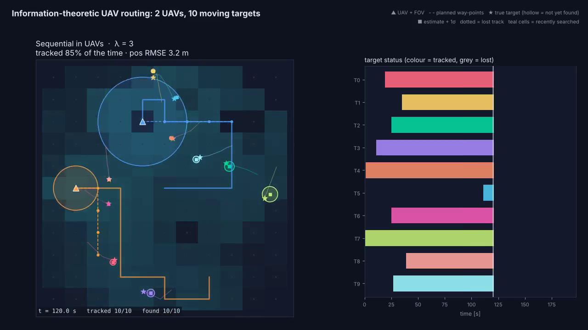
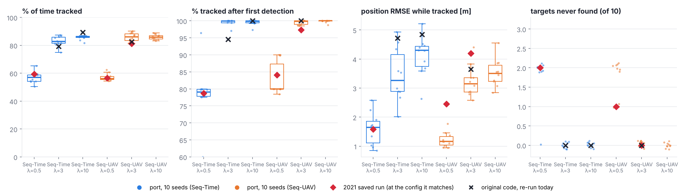
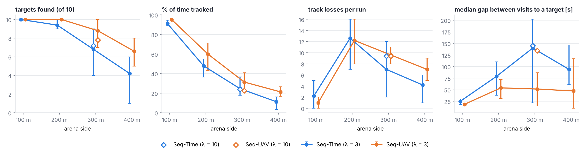
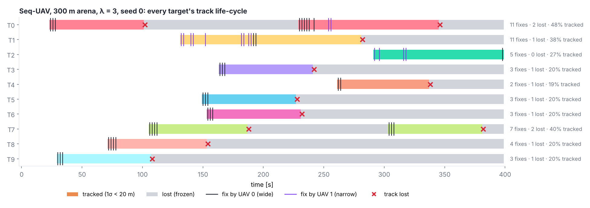

# Information-theoretic UAV sensor path planning — Python reproduction

Clean NumPy reproduction of

> N. Adurthi, P. Singla, M. Majji, **"Information Theoretic Sensor Path Planning: Applications to UAV Routing"** (journal draft, 2021).

Two UAVs with circular, downward-looking fields of view are routed on a grid to discover and track ten moving ground targets whose positions are only known through EKF beliefs. Paths are chosen to maximise Gaussian mutual information plus a λ-weighted coverage (search) term, using the paper's two greedy approximations to the combinatorial joint search: **sequential in UAVs** and **sequential in time**.

Write-up with the math and videos: <https://perceptionstack.dev/tutorials/applications/uav-sensor-path-planning/>

<p align="center"></p>

Videos: [`media/videos/`](media/videos) (Seq-UAV, Seq-Time, side-by-side, λ sweep, candidate-scoring explainer).

## What is here

```
sensorplan/
  models.py      CV target model (speed-capped), circular-FOV position sensor, KF update,
                 1σ-ellipse/FOV overlap gate, binary Markov coverage map
  grid.py        node grid, reachable sets, trajectory enumeration (verbatim port of the
                 original generator + its node-set filter)
  planners.py    Gaussian MI, batched path scoring, seq_uav, seq_time, joint_exhaustive
  simulate.py    closed-loop receding-horizon simulation + the paper's tracking metrics
  animate.py     MP4 renderer
scripts/
  run_benchmark.py           2 planners × λ ∈ {0.5, 3, 10} × 10 seeds on the 2021 scenario
  make_figures.py            box plots / summary table from the benchmark
  make_videos.py             the five videos on the blog
  check_against_original.py  component checks against the original ResearchCodes functions
data/
  scenario_2021.npz          ground truth of the 10 targets used for every 2021 run (from testcase.pkl)
  original_2021_metrics.csv  per-target metrics of the three saved 2021 runs
  uav_paths_2021_*.npy       UAV way-points of those runs
results/, media/             outputs
```

Only `numpy`, `scipy`, `pandas` and `matplotlib` are needed (plus `ffmpeg` for videos).

```bash
python scripts/run_benchmark.py --seeds 10     # ~15 min on one core
python scripts/make_figures.py
python scripts/make_videos.py
```

```python
import numpy as np
from sensorplan import run, SimConfig, metrics, summary
d = np.load("data/scenario_2021.npz")
res = run(d["truth"], d["t"], SimConfig(method="seq_uav", lam=3.0, seed=0))
print(summary(metrics(res)))
```

## Setup (taken from the original code — the paper's simulation section is still a skeleton)

| | |
|---|---|
| World | 0–100 m square, node grid every 10 m (11 × 11), Δt = 2 s, 200 s |
| UAVs | start at (70,70) and (30,30); move to a 4-neighbour every step (no hovering) |
| Sensors | UAV 0: FOV radius 20 m, σ = 1 m · UAV 1: FOV 10 m, σ = 0.2 m · measure target (x, y) |
| Targets | 10 (the paper text says 8), near-constant velocity 0.3 m/s with random heading nudges, EKF with q = 0.0016 |
| Track init / loss | initialised at first detection with P₀ = diag(5², 5², 0.2², 0.2²); lost when a 1σ axis exceeds 20 m |
| Planner | horizon 4 moves (5 way-points), re-plan every 3 steps; a target counts as measured in planning if > 30 % of its 1σ ellipse is in the FOV |
| Objective | Σ ½ ln(\|P⁻\|/\|P⁺\|) over targets and steps + λ × Σ binary-entropy drop of a 121-cell coverage map (TP = 0.9, FP = 0.1, stay prob. 0.99) |

## Results

`results/benchmark_summary.csv`, 10 noise seeds per configuration, same ground truth as 2021:

| planner | λ | % time tracked | % tracked after first detection | pos RMSE [m] | never found | s / run |
|---|---|---|---|---|---|---|
| Seq-Time | 0.5 | 56.9 ± 4.1 | 78.8 | 1.60 | 2.0 | 1.2 |
| Seq-Time | 3 | 83.0 ± 3.8 | 99.0 | 3.44 | 0 | 1.9 |
| Seq-Time | 10 | 85.8 ± 2.1 | 99.5 | 4.10 | 0 | 1.9 |
| Seq-UAV | 0.5 | 57.1 ± 2.6 | 82.8 | 1.22 | 1.7 | 15 |
| Seq-UAV | 3 | 85.8 ± 3.2 | 99.5 | 3.24 | 0 | 27 |
| Seq-UAV | 10 | 85.9 ± 1.9 | 99.8 | 3.53 | 0 | 25 |



RMSE is averaged over the time each target is tracked, so the low-λ runs look more accurate partly because they only keep the targets they are already close to.

### Matching the 2021 saved runs

The three 2021 result folders all share one ground-truth scenario. Seq-UAV (λ = 3) matches directly. The other two do not match their labels, and the code history explains why:

* **"Seq-Time, λ = 3"** — at the commit of 9 Apr 2021 the main script called `exhaustive_seq_time(..., searchMIwt=0.5)` with the weight **hard-coded to 0.5**, while the logged setting said 3. The port at λ = 0.5 reproduces that run: 57 % vs 59 % of time tracked, 79 % vs 79 % after discovery, and the same two targets never found in every seed.
* **"Seq-Time-MIlamda10"** — its saved script has the Seq-UAV planner active, and it matches Seq-UAV at λ = 0.5: 58 % vs 56 % tracked, 83 % vs 84 % after discovery, and the same missed target (T8). This is the most consistent explanation, not a certainty.

### Running the original code

`ResearchCodes/main_dynSensorTasking_Exhaustive.py` runs again with these changes only:

1. copy `turtlebot/uq` to `uq/` (the top-level `uq/` is empty in the repo, so `uq.information.distance` is missing);
2. `pip install shapely numba dill gitpython redis rq pyperclip scikit-learn`;
3. run inside a git repository with an existing `simulations/` folder (`SimManager` requires both);
4. Matplotlib ≥ 3.6: `Polygon(Xfov, True, ...)` → `Polygon(Xfov, closed=True, ...)` in `physmodels/sensormodels_fov.py`;
5. NumPy ≥ 1.24: `np.int` → `int` in `utils/math/gen_seq.py`.

Re-run on the 2021 scenario (one unseeded run each): Seq-UAV λ = 3 → 82.6 % tracked, 3.65 m RMSE (472 s, 8 processes); Seq-Time λ = 3 → 79.2 %, 4.72 m; Seq-Time λ = 10 → 89.3 %, 4.85 m — all inside the port's seed-to-seed spread. The port runs Seq-UAV in ~26 s on one core by scoring all candidate paths in one batched NumPy pass.

`scripts/check_against_original.py` compares components directly: MI and coverage updates agree to machine precision, trajectory enumeration is identical in content and order, and the vectorised overlap gate agrees with the shapely version to within 0.01.

### Differences from the paper text

* The paper describes pruning candidates to those whose FOV touches a 3σ ellipse, and a "fly to the closest target" fallback when that set is empty. The code does neither; the λ-weighted coverage term is what pulls UAVs toward unexplored areas. The port follows the code.
* The code's enumerator keeps only the first trajectory for each *set* of visited nodes (184 of the 254 four-step paths from either start node). The port keeps this, and `enumerate_trajectories(..., faithful=False)` gives the full set.
* Mean speed is clipped to 0.3 m/s inside every EKF prediction, as in the original motion model.

## Large arena: when distance is the bottleneck

`python scripts/run_large_arena.py` keeps the two UAVs (5 m/s, FOV 20 m / 10 m) and 10 targets but grows the
arena from the paper's 100 m to 400 m (400 s, 5 random scenarios each, both planners, λ = 3; plus λ = 10 at 300 m).
`sensorplan.scenario.track_report` gives one row per target: first detection, fixes, visits, re-acquisitions,
losses, longest lost / blind stretch, % tracked, RMSE and % of time the truth is outside 3σ.

| arena | planner | found /10 | % time tracked | losses / run | median gap between visits |
|---|---|---|---|---|---|
| 100 m | Seq-Time / Seq-UAV | 10.0 / 10.0 | 91 / 95 | 2.2 / 1.0 | 25 s / 19 s |
| 200 m | Seq-Time / Seq-UAV | 9.4 / 10.0 | 48 / 60 | 12.6 / 12.2 | 79 s / 54 s |
| 300 m | Seq-Time / Seq-UAV | 6.8 / 8.8 | 25 / 31 | 7.0 / 9.6 | 140 s / 52 s |
| 400 m | Seq-Time / Seq-UAV | 4.2 / 6.6 | 11 / 21 | 4.2 / 7.0 | 94 s / 47 s |




## Citation

If you use this code, please cite the paper above.
